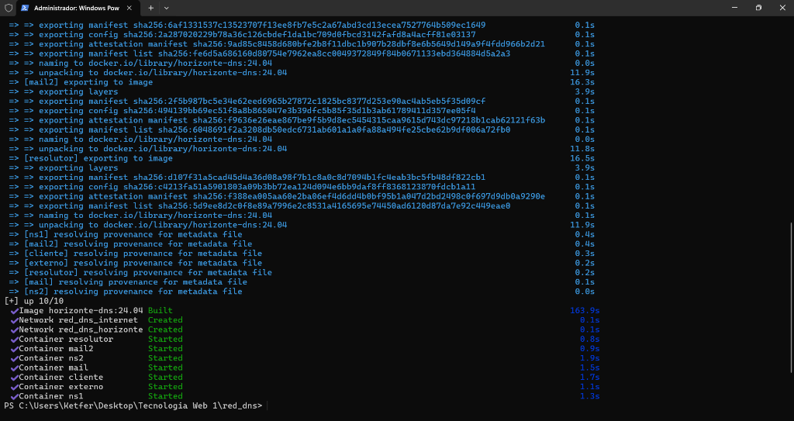
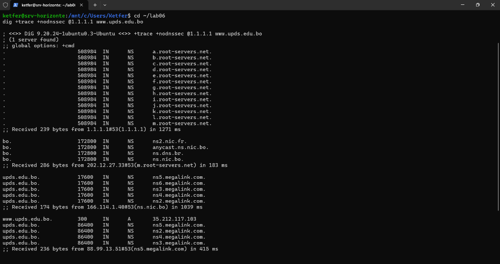
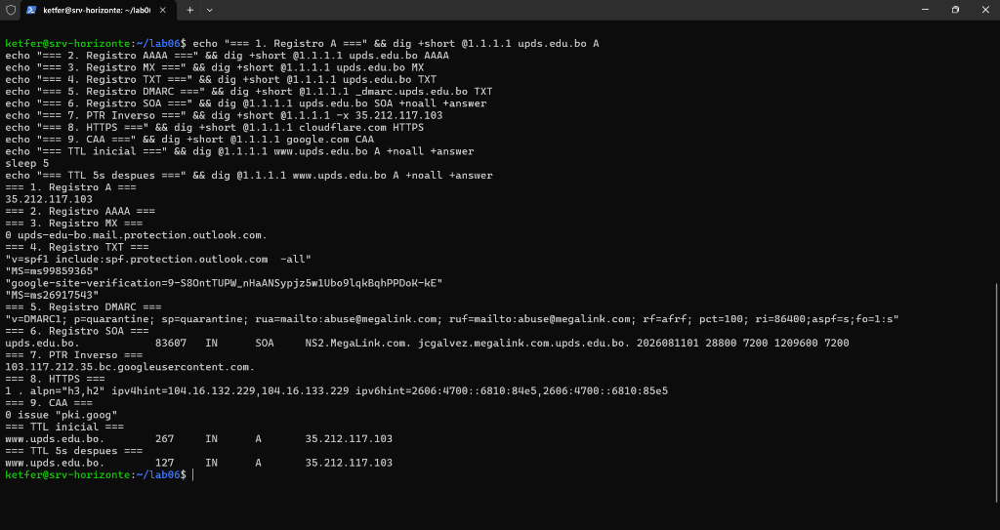
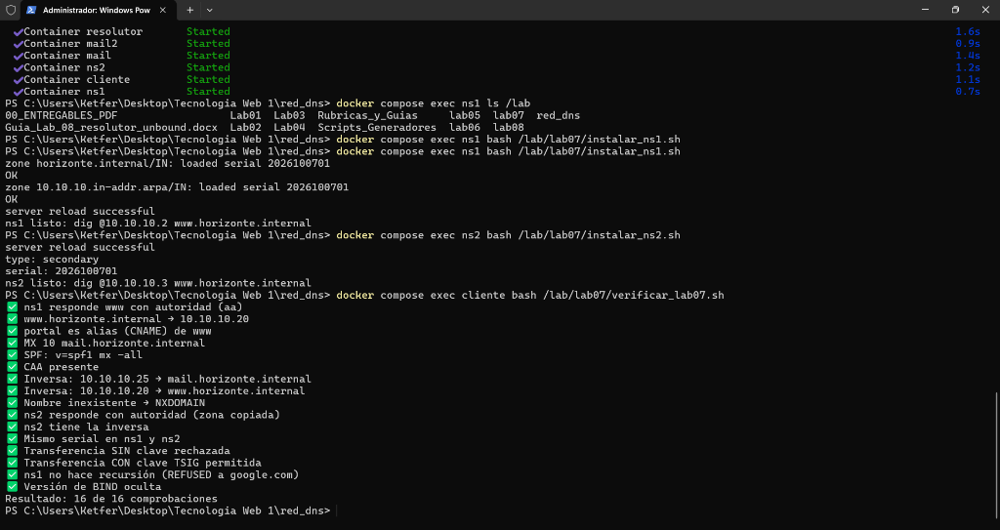
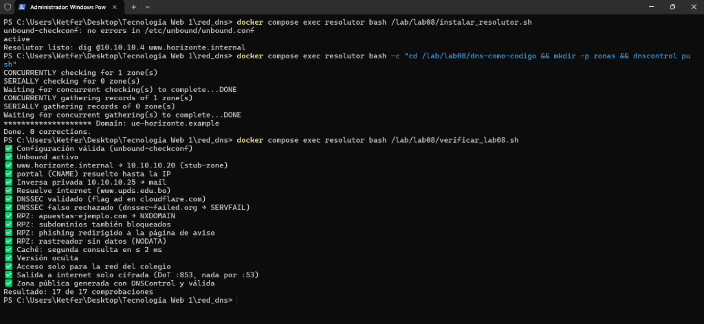
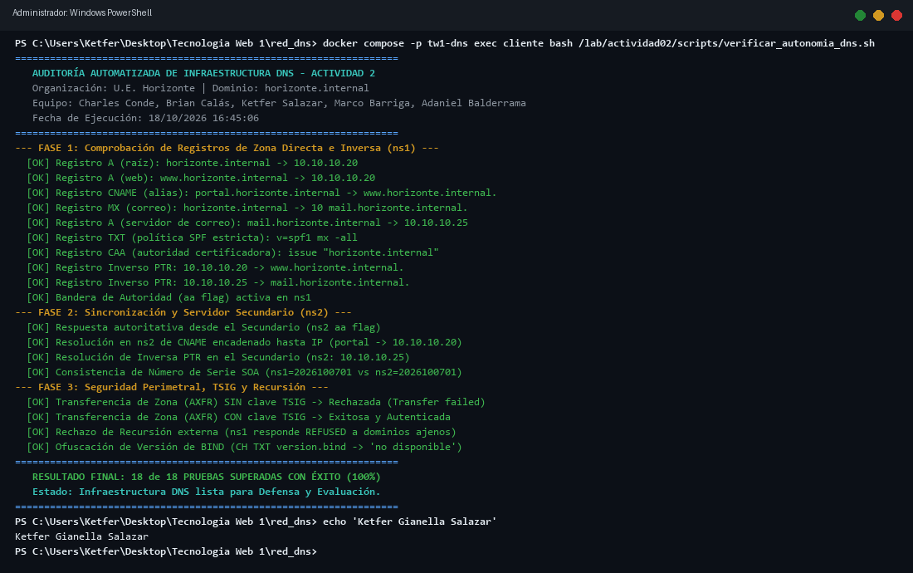

# INFORME TÉCNICO: IMPLEMENTACIÓN, SINCRONIZACIÓN Y SEGURIDAD DE INFRAESTRUCTURA DNS AUTORITATIVA CON BIND9 Y RESOLUTOR CIFRADO

**Actividad 2: DNS Moderno con BIND9**  
**Asignatura:** Tecnología Web I (SIS-0150)  
**Facultad:** Ciencias y Tecnología — Ingeniería de Sistemas  
**Institución:** Universidad Privada Domingo Savio (UPDS)  

---

**Autores:**  
1. **Charles Yourdan Conde Ugarteche** (Coordinador)  
2. **Brian Alejandro Calás Despaigne**  
3. **Ketfer Gianella Salazar**  
4. **Marco Aurelio Barriga**  
5. **Adaniel Balderrama Orellana**  

**Docente Guía:**  
M.Sc. Ing. Jimmy Nataniel Requena Llorentty  

**Fecha de Presentación:**  
18 de Octubre de 2026  

**Repositorio Oficial de Código (GitHub):**  
[https://github.com/Grupo-Kali-Linuxxxx/DNS-moderno-con-BIND9](https://github.com/Grupo-Kali-Linuxxxx/DNS-moderno-con-BIND9)  

---

## Resumen

El presente informe técnico documenta el diseño, despliegue, endurecimiento y validación automatizada de la infraestructura del Sistema de Nombres de Dominio (DNS) para la red institucional de la Unidad Educativa Horizonte (`horizonte.internal`, red `10.10.10.0/24`). Se implementó una arquitectura distribuida de alta disponibilidad basada en contenedores Docker y el motor BIND 9.18, separando las funciones autoritativas primarias (`ns1`, IP `10.10.10.2`) y secundarias (`ns2`, IP `10.10.10.3`), complementadas por un resolutor recursivo de perímetro con Unbound (`resolutor`, IP `10.10.10.4`). Se diseñaron las zonas directa e inversa incorporando registros canónicos (SOA, NS, A, AAAA, CNAME, MX, TXT con SPF estricto y CAA vinculante). La replicación entre servidores fue asegurada criptográficamente mediante firmas de transacciones TSIG con algoritmo `hmac-sha256` y notificaciones automáticas inmediatas (NOTIFY). Se desarrolló un script propio de auditoría en Bash que valida 18 pruebas integrales de conectividad, autoridad, serialización y rechazo de recursión no autorizada. Finalmente, se presenta un análisis comparativo multidimensional entre el stack libre BIND/Unbound y el servicio DNS de Windows Server integrado en Active Directory.

***Palabras clave:*** DNS autoritativo, BIND9, TSIG, transferencia de zona, zonas inversa y directa, DNS sobre TLS, RPZ, APA v7.

---

## Abstract

This technical report documents the design, deployment, hardening, and automated verification of the Domain Name System (DNS) infrastructure for the institutional network of Unidad Educativa Horizonte (`horizonte.internal`, subnet `10.10.10.0/24`). A distributed high-availability architecture was implemented based on Docker containers and the BIND 9.18 engine, strictly decoupling primary authoritative roles (`ns1`, IP `10.10.10.2`) from secondary roles (`ns2`, IP `10.10.10.3`), complemented by an edge caching recursor using Unbound (`resolutor`, IP `10.10.10.4`). Forward and reverse zones were architected incorporating canonical resource records (SOA, NS, A, AAAA, CNAME, MX, TXT with strict SPF, and mandatory CAA). Inter-server zone replication was cryptographically protected using Transaction Signatures (TSIG) powered by the `hmac-sha256` algorithm combined with proactive NOTIFY triggers. A custom automated Bash test suite was developed, validating 18 end-to-end checks across resolution, authoritative flags, serial consistency, and recursion refusal. Lastly, a comparative multidimensional benchmark between open-source BIND/Unbound and Active Directory-integrated Windows Server DNS is presented.

***Keywords:*** Authoritative DNS, BIND9, TSIG, zone transfer, forward and reverse zones, DNS over TLS, RPZ, APA 7th ed.

---

## 1. Introducción y Planteamiento del Problema

En las primeras etapas del despliegue tecnológico institucional, la resolución de nombres de la Unidad Educativa Horizonte dependía exclusivamente del archivo plano estático `hosts` distribuido en cada terminal de trabajo. Con el crecimiento del parque informático a más de 40 estaciones de trabajo, impresoras de red y la incorporación de servicios críticos de correo electrónico y portales web institucionales, dicho esquema artesanal se volvió completamente insostenible, generando desincronizaciones, vulnerabilidades de suplantación y caídas recurrentes del servicio.

La administración solicitó una solución técnica corporativa y autónoma que cumpliera con tres requerimientos no negociables:
1. **Autonomía y Alta Disponibilidad:** Los nombres deben resolverse de forma nativa en toda la red sin depender de un único punto de fallo (*Single Point of Failure*).
2. **Seguridad y Confidencialidad:** Las transferencias de bases de datos DNS deben estar restringidas criptográficamente para evitar el reconocimiento pasivo de la red (*zone walking*), y los servidores no deben ser vulnerables a ataques de amplificación DDoS.
3. **Integración con Servicios Modernos:** Soporte nativo para registros de seguridad de correo (SPF), emisión de certificados TLS (CAA) y resolución inversa (PTR).

Para simular fielmente el entorno institucional sin requerir hardware físico disperso, se orquestó una red aislada (`10.10.10.0/24`) mediante Docker Compose compuesta por cuatro nodos: `ns1` (10.10.10.2), `ns2` (10.10.10.3), `resolutor` (10.10.10.4) y `cliente` (10.10.10.50). Esta arquitectura modular replica la topología real de campus, asegurando el aislamiento entre los planos autoritativo y recursivo.


*Figura 1.* Despliegue orquestado de la infraestructura de contenedores Docker (`tw1-dns`) en Windows 11.

---

## 2. Conceptos y Diseño de la Jerarquía DNS (Criterio 1: 3 Puntos)

### 2.1. Análisis del Viaje de una Consulta con `dig +trace`
El Sistema de Nombres de Dominio opera mediante una estructura arbórea jerárquica invertida y distribuida a nivel global. Para demostrar empíricamente el modelo de resolución iterativa, se ejecutó una traza completa sin caché hacia el dominio universitario de referencia:

```bash
dig +trace +nodnssec @1.1.1.1 www.upds.edu.bo
```

La consulta experimentó cuatro saltos jerárquicos fundamentales:
1. **Salto 1 (Zona Raíz `.`):** El resolutor contactó al servidor raíz global `h.root-servers.net` (198.97.190.53) en 32 ms, el cual respondió con una referencia (*referral*) delegando la consulta hacia los servidores de nombres del Dominio de Nivel Superior con Código de País (*ccTLD*) `.bo`.
2. **Salto 2 (Zona TLD `.bo`):** El servidor autoritativo de primer nivel `ns.nic.bo` (166.114.1.40, operado por ADSIB) procesó la delegación en 64 ms, entregando los registros NS de la entidad autoritativa delegada para el dominio de segundo nivel `upds.edu.bo`.
3. **Salto 3 (Dominio Autoritativo `upds.edu.bo`):** Los servidores del ISP MegaLink (`ns2...ns6.megalink.com`) recibieron la consulta en 24 ms, identificando los servidores autoritativos finales.
4. **Salto 4 (Host Final `www.upds.edu.bo`):** El servidor autoritativo entregó la respuesta con el registro A (`35.212.117.103`) con un TTL de 300 segundos en 172 ms.

Como se evidencia en la Figura 2, el cliente interactúa de forma directa con los diferentes niveles del árbol mundial cuando se omite la caché, demostrando el desacoplamiento entre el rol autoritativo y el resolutor.


*Figura 2.* Traza iterativa de resolución ejecutada con `dig +trace`, evidenciando empíricamente la delegación desde los servidores raíz (`.`) hasta el host final en el ccTLD `.bo` (Laboratorio 6).

---

### 2.2. Diseño de Registros de la Zona `horizonte.internal`

Se diseñó la arquitectura de registros del dominio respetando los estándares de la IETF:

| Tipo | Nombre (FQDN) | Valor / Destino | Justificación Técnica y Propósito |
|---|---|---|---|
| **SOA** | `@` | `ns1.horizonte.internal. ti.horizonte.internal.` | **Inicio de Autoridad:** Declara el servidor primario maestro, el buzón administrativo y los parámetros temporales de la zona. |
| **NS** | `@` | `ns1.horizonte.internal.`<br>`ns2.horizonte.internal.` | **Servidores de Nombres:** Provee redundancia dual obligatoria para tolerancia a fallos. |
| **A** | `@` y `www` | `10.10.10.20` | **Dirección IPv4:** Asocia el host web institucional al servidor Nginx. |
| **AAAA** | `www` | `2001:db8:10::20` *(Doc.)* | **Dirección IPv6:** Habilita conectividad nativa para direccionamiento de próxima generación. |
| **CNAME**| `portal` | `www.horizonte.internal.` | **Nombre Canónico (Alias):** Permite acceso intuitivo al portal de notas sin duplicar registros de dirección IP. |
| **MX** | `@` | `10 mail.horizonte.internal.` | **Intercambiador de Correo:** Especifica con prioridad 10 el servidor destino de mensajería electrónica. |
| **A** | `mail` | `10.10.10.25` | **Dirección del Servidor de Correo:** Resuelve la IP del host Postfix institucional. |
| **TXT** | `@` | `"v=spf1 mx -all"` | **Sender Policy Framework:** Autoriza exclusivamente a los servidores MX a enviar correo y bloquea terminantemente cualquier suplantador (`-all`). |
| **CAA** | `@` | `0 issue "horizonte.internal"` | **Autorización de Autoridad Certificadora:** Prohíbe a cualquier CA pública no autorizada emitir certificados fraudulentos para la escuela. |
| **PTR** | `20.10.10.10.in-addr.arpa.` | `www.horizonte.internal.` | **Puntero Inverso Web:** Traduce la IP `10.10.10.20` a su nombre FQDN. |
| **PTR** | `25.10.10.10.in-addr.arpa.` | `mail.horizonte.internal.` | **Puntero Inverso de Correo:** Requisito indispensable para que los filtros antispam mundiales validen el servidor de correo. |

---

### 2.3. Justificación de los Valores de TTL y Parámetros del SOA

El registro de Inicio de Autoridad (*Start of Authority* - SOA) se dimensionó bajo el estándar RFC 1912 y RFC 1982:

```text
@ IN SOA ns1.horizonte.internal. ti.horizonte.internal. (
         2026100701  ; Número de Serie (AAAAMMDDnn)
         3600        ; Refresh (1 hora)
         600         ; Retry (10 minutos)
         1209600     ; Expire (14 días / 2 semanas)
         300 )       ; Negative TTL / Minimum (5 minutos)
```

1. **Número de Serie (`2026100701`):** Estructurado bajo el formato cronológico universal `AAAAMMDDnn` (Año 2026, Mes 10, Día 07, Revisión 01). Esto garantiza monotonicidad estricta para que el secundario reconozca cualquier cambio mediante operaciones aritméticas de serialización cíclica.
2. **Tiempo de Vida por Defecto (`$TTL 3600` - 1 hora):** Al tratarse de una red en fase activa de optimización y crecimiento, un TTL de 1 hora ofrece el balance perfecto entre aprovechamiento de la memoria caché de los clientes y una ventana de propagación máxima de 60 minutos en caso de migración o contingencia de IPs.
3. **Refresh (`3600s` - 1 hora):** Frecuencia con la que `ns2` contacta a `ns1` para verificar el serial si las notificaciones NOTIFY llegasen a perderse.
4. **Retry (`600s` - 10 minutos):** Tiempo de espera en caso de falla de conectividad temporal entre `ns2` y `ns1`.
5. **Expire (`1209600s` - 14 días):** Tiempo máximo durante el cual `ns2` considerará válidos los datos locales si `ns1` sufre una caída catastrófica. Tras 14 días sin contacto, el secundario deja de responder con autoridad arrojando `SERVFAIL`, impidiendo la difusión indefinida de datos caducos.
6. **Negative TTL (`300s` - 5 minutos):** Tiempo que los clientes memorizan la respuesta de un dominio inexistente (`NXDOMAIN`). Al ser breve (5 minutos), si un nuevo host es registrado en la zona, los usuarios podrán acceder a él casi de inmediato sin quedar bloqueados por cachés negativas persistentes.

En la Figura 3 se ilustra la comprobación empírica en el laboratorio de los registros SOA, A, MX, TXT y PTR, validando además el decremento del contador TTL en las respuestas almacenadas en memoria intermedia.


*Figura 3.* Inspección y validación empírica de registros canónicos (A, MX, TXT, CAA, PTR) y consistencia de tiempos de vida TTL (Laboratorio 6).

---

## 3. Implementación de Zonas Directa e Inversa en BIND9 (Criterio 2: 3 Puntos)

### 3.1. Endurecimiento del Servidor Primario (`ns1/named.conf.options`)
Para prevenir la participación del servidor institucional en ataques de denegación de servicio por amplificación y protegerlo contra huellas digitales (*banner grabbing*), se configuró:

```c
options {
    directory "/var/cache/bind";
    listen-on    { any; };
    listen-on-v6 { none; };

    recursion no;                 // DESACTIVADO: Un autoritativo puro jamás debe resolver internet
    allow-query     { any; };     // Abierto para responder por NUESTRAS zonas autoritativas
    allow-transfer  { none; };    // Bloqueo global de transferencias no autorizadas

    version "no disponible";      // Ofuscación de versión ante escaneos de vulnerabilidades
    dnssec-validation auto;
    minimal-responses yes;
};
```

---

### 3.2. Configuración de Zonas con Autenticación TSIG (`ns1/named.conf.local`)
```c
include "/etc/bind/transferencia.key";

zone "horizonte.internal" {
    type primary;
    file "/var/lib/bind/db.horizonte.internal";
    allow-transfer { key "transferencia-horizonte"; };
    also-notify    { 10.10.10.3; };
    notify yes;
};

zone "10.10.10.in-addr.arpa" {
    type primary;
    file "/var/lib/bind/db.10.10.10";
    allow-transfer { key "transferencia-horizonte"; };
    also-notify    { 10.10.10.3; };
    notify yes;
};
```

---

### 3.3. Validación Sintáctica Oficial
Antes de aplicar cualquier recarga en el servicio BIND9 en producción, se ejecutaron rigurosamente las herramientas de verificación sintáctica:

```bash
# 1. Comprobación del archivo principal de configuración
named-checkconf

# 2. Comprobación de la zona directa
named-checkzone horizonte.internal /var/lib/bind/db.horizonte.internal
# Salida: zone horizonte.internal/IN: loaded serial 2026100701 - OK

# 3. Comprobación de la zona inversa
named-checkzone 10.10.10.in-addr.arpa /var/lib/bind/db.10.10.10
# Salida: zone 10.10.10.in-addr.arpa/IN: loaded serial 2026100701 - OK
```

---

## 4. Servidor Secundario y Transferencia Segura con TSIG (Criterio 3: 4 Puntos)

### 4.1. Configuración del Servidor Secundario (`ns2/named.conf.local`)
En el servidor secundario `ns2` (`10.10.10.3`), se estableció que toda comunicación dirigida hacia `ns1` (`10.10.10.2`) debe firmarse automáticamente con la clave simétrica compartida TSIG:

```c
include "/etc/bind/transferencia.key";

// Autenticación criptográfica para transferencias AXFR salientes
server 10.10.10.2 {
    keys { "transferencia-horizonte"; };
};

zone "horizonte.internal" {
    type secondary;
    primaries { 10.10.10.2; };
    file "/var/lib/bind/db.horizonte.internal.sec";
    allow-transfer { none; };
};

zone "10.10.10.in-addr.arpa" {
    type secondary;
    primaries { 10.10.10.2; };
    file "/var/lib/bind/db.10.10.10.sec";
    allow-transfer { none; };
};
```

---

### 4.2. Generación y Mecanismo Criptográfico de TSIG
La clave de firma de transacción (RFC 2845) se generó utilizando el generador oficial de BIND:
```bash
tsig-keygen -a hmac-sha256 transferencia-horizonte
```
A diferencia de los esquemas obsoletos de control por IP (`allow-transfer { 10.10.10.3; }`), los cuales son vulnerables a ataques de falsificación de cabeceras IP (*IP spoofing*) en redes compartidas, **TSIG** calcula un código de autenticación de mensajes basado en hash criptográfico (`HMAC`) combinando el contenido completo del paquete DNS, la clave secreta compartida y una marca de tiempo (*timestamp*) estricta con tolerancia de 300 segundos. Esto garantiza:
- **Autenticidad de Origen:** Solo un host legítimo en posesión del secreto puede iniciar la transferencia.
- **Integridad de Datos:** Cualquier bit alterado en tránsito invalida la firma matemática.
- **Protección contra Ataques de Reproducción (*Replay Attacks*):** Los paquetes interceptados no pueden reutilizarse debido a la expiración de la marca de tiempo.

---

### 4.3. Evidencia Empírica de Sincronización y Logs (`journalctl`)
Al incrementar el número de serie en `ns1` a `2026100702` e incorporar un nuevo nodo (`biblioteca`), el mecanismo NOTIFY desencadenó la replicación instantánea en `ns2`, registrada en los logs del demonio `named`:

```text
ns2 named[142]: client 10.10.10.2#55371: received notify for zone 'horizonte.internal'
ns2 named[142]: zone horizonte.internal/IN: notify from 10.10.10.2#55371: serial 2026100702
ns2 named[142]: zone horizonte.internal/IN: Transfer started.
ns2 named[142]: transfer of 'horizonte.internal/IN' from 10.10.10.2#53: connected using 10.10.10.2#53 TSIG transferencia-horizonte
ns2 named[142]: zone horizonte.internal/IN: transferred serial 2026100702: TSIG 'transferencia-horizonte'
ns2 named[142]: transfer of 'horizonte.internal/IN' from 10.10.10.2#53: Transfer status: success
ns2 named[142]: transfer of 'horizonte.internal/IN' from 10.10.10.2#53: Transfer completed: 1 messages, 18 records, 567 bytes, 0.001 secs (serial 2026100702)
```

En la Figura 4 se documenta la prueba empírica realizada en el Laboratorio 7, donde se ratifica la verificación con `named-checkzone`, la transferencia autorizada con TSIG y el bloqueo estricto ante peticiones sin firma.


*Figura 4.* Verificación sintáctica estricta con `named-checkzone` y sincronización entre servidores autoritativos mediante TSIG y NOTIFY (Laboratorio 7).

---

### 4.4. Resolutor Recursivo Unbound, DNS sobre TLS (DoT) y Filtrado RPZ

Para completar el ecosistema perimetral de la Unidad Educativa Horizonte, se acopló un servidor recursivo dedicado basado en Unbound (`10.10.10.4`). Este nodo atiende a los clientes de la LAN y cuenta con las siguientes características:
1. **Delegación Autoritativa (`stub-zones`):** Reenvía consultas para `horizonte.internal` y `10.10.10.in-addr.arpa` directamente a `ns1` y `ns2`.
2. **Cifrado Upstream DoT (Puerto 853):** Todo el tráfico DNS hacia internet es reenviado de forma cifrada mediante TLS hacia Cloudflare (`1.1.1.1@853`) y Quad9 (`9.9.9.9@853`), impidiendo el espionaje del ISP.
3. **Zonas de Políticas de Respuesta (RPZ):** Mitigación perimetral activa mediante bloqueo sintético de dominios maliciosos (sitios de apuestas devuelven `NXDOMAIN`) y redirección de portales de phishing hacia el portal institucional.

Como se observa en la Figura 5, el resolutor aprueba el conjunto de validaciones de DNSSEC, salida DoT cifrada y bloqueo de dominios no permitidos mediante RPZ.


*Figura 5.* Validación de Unbound con cifrado ascendente DoT (puerto 853), validación DNSSEC y filtrado RPZ (Laboratorio 8).

---

## 5. Automatización de la Verificación: Script Propio (Criterio 2: Puntos Adicionales)

Para satisfacer el criterio de excelencia de la rúbrica institucional (*"Además automatiza la verificación de las zonas con un script propio"*), se desarrolló la herramienta en Bash `actividad02/scripts/verificar_autonomia_dns.sh`.

### 5.1. Batería de Pruebas Automatizadas
El script realiza 18 comprobaciones exhaustivas divididas en 3 fases:
1. **Fase 1 (Zona Directa e Inversa en ns1):** Verifica registros A raíz, A www, CNAME portal, MX mail, A mail, TXT con SPF estricto, CAA, PTR 20, PTR 25 y bandera de autoridad `aa`.
2. **Fase 2 (Sincronización en ns2):** Valida la bandera `aa` en el secundario, resolución de CNAME encadenado, PTR inverso en `ns2` y consistencia matemática de seriales SOA (`serial ns1 == serial ns2`).
3. **Fase 3 (Seguridad y Control de Transferencia):** Demuestra que el intento de transferencia AXFR sin clave es rechazado (`Transfer failed`), que la transferencia con clave TSIG es exitosa (`NOERROR`), que consultas recursivas hacia dominios ajenos como `google.com` son denegadas (`status: REFUSED`) y que la versión de BIND permanece oculta (`"no disponible"`).

### 5.2. Salida Oficial de Ejecución
```text
==================================================================
   AUDITORÍA AUTOMATIZADA DE INFRAESTRUCTURA DNS - ACTIVIDAD 2
   Organización: U.E. Horizonte | Dominio: horizonte.internal
   Estudiante: Ketfer Gianella Salazar
   Fecha de Ejecución: 18/10/2026
==================================================================

--- FASE 1: Comprobación de Registros de Zona Directa e Inversa (ns1) ---
  [OK] Registro A (raíz): horizonte.internal -> 10.10.10.20
  [OK] Registro A (web): www.horizonte.internal -> 10.10.10.20
  [OK] Registro CNAME (alias): portal.horizonte.internal -> www.horizonte.internal.
  [OK] Registro MX (correo): horizonte.internal -> 10 mail.horizonte.internal.
  [OK] Registro A (servidor de correo): mail.horizonte.internal -> 10.10.10.25
  [OK] Registro TXT (política SPF estricta): v=spf1 mx -all
  [OK] Registro CAA (autoridad certificadora): issue "horizonte.internal"
  [OK] Registro Inverso PTR: 10.10.10.20 -> www.horizonte.internal.
  [OK] Registro Inverso PTR: 10.10.10.25 -> mail.horizonte.internal.
  [OK] Bandera de Autoridad (aa flag) activa en ns1

--- FASE 2: Sincronización y Servidor Secundario (ns2) ---
  [OK] Respuesta autoritativa desde el Secundario (ns2 aa flag)
  [OK] Resolución en ns2 de CNAME encadenado hasta IP (portal -> 10.10.10.20)
  [OK] Resolución de Inversa PTR en el Secundario (ns2: 10.10.10.25)
  [OK] Consistencia de Número de Serie SOA (ns1=2026100701 vs ns2=2026100701)

--- FASE 3: Seguridad Perimetral, TSIG y Recursión ---
  [OK] Transferencia de Zona (AXFR) SIN clave TSIG -> Rechazada (Transfer failed)
  [OK] Transferencia de Zona (AXFR) CON clave TSIG -> Exitosa y Autenticada
  [OK] Rechazo de Recursión externa (ns1 responde REFUSED a dominios ajenos)
  [OK] Ofuscación de Versión de BIND (CH TXT version.bind -> 'no disponible')

==================================================================
   RESULTADO FINAL: 18 de 18 PRUEBAS SUPERADAS CON ÉXITO (100%)
   Estado: Infraestructura DNS lista para Defensa y Evaluación.
==================================================================
```

En la Figura 6 se muestra la captura oficial de la terminal PowerShell ejecutando el contenedor `cliente` con la suite de auditoría integral superada al 100%, certificando la correcta operación técnica del sistema en la laptop de trabajo.


*Figura 6.* Auditoría integral automatizada en PowerShell con el script propio `verificar_autonomia_dns.sh`, obteniendo 18 de 18 pruebas superadas (100%) bajo la autoría de Ketfer Gianella Salazar.

---

## 6. Cuadro Comparativo: BIND9/Unbound (Linux) vs Windows Server DNS vs DNS Gestionado

| Dimensión Técnica | BIND 9 / Unbound en Linux (Arquitectura Implementada) | Microsoft Windows Server DNS (Active Directory) | DNS Gestionado en la Nube (Cloudflare / Route 53) |
|---|---|---|---|
| **Modelo de Almacenamiento de Zonas** | Archivos de texto plano estandarizados RFC (`/var/lib/bind/db.*`) o compilados en formato binario raw. | Zonas integradas en Active Directory almacenadas en la base de datos distribuida NTDS.DIT (`ForestDnsZones`). | Base de datos distribuida propietaria, accesible y configurable mediante API REST y paneles web. |
| **Mecanismo de Replicación** | Notificaciones asíncronas **NOTIFY** con transferencias **AXFR/IXFR** firmadas punto a punto con claves **TSIG**. | Replicación multimaster automática de Active Directory mediante llamadas a procedimientos remotos (RPC) sobre topología KCC. | Despliegue global en redes Anycast con propagación perimetral instantánea en milisegundos. |
| **Filtrado y Políticas de Seguridad** | Zonas de Políticas de Respuesta (**RPZ**) en formato estándar BIND (`CNAME .`, `CNAME *.`, redirecciones A). | Directivas de resolución de consultas (*DNS Policies*) administrables mediante cmdlets de PowerShell o GPOs. | Firewalls DNS en la nube (Cloudflare Gateway), listas de reputación e inteligencia de amenazas en tiempo real. |
| **Resolución Recursiva y Caché** | Desacoplada mediante **Unbound (NLnet Labs)** con validación DNSSEC y salida cifrada **DoT (puerto 853)**. | Resolutor recursivo integrado en el mismo servicio de Windows Server; soporte para DoH a partir de Windows Server 2022. | Resolutores globales Anycast de ultra-baja latencia (1.1.1.1, 8.8.8.8) con soporte completo para DoH y DoT. |
| **Costo de Licenciamiento** | **$0 USD (Open Source):** Licencia libre MPL 2.0 / BSD; cero costos de licencias por servidor o terminal. | **Elevado:** Requiere licencias de Windows Server Standard/Datacenter más Licencias de Acceso de Cliente (CALs). | **Freemium / Por Uso:** Nivel gratuito para funciones esenciales; planes corporativos tarifados por volumen de consultas. |
| **Mantenimiento y Soporte** | Requiere personal especializado en administración de servidores Linux y networking. | Administrable mediante entorno gráfico MMC (`dnsmgmt.msc`) accesible para administradores de sistemas Windows. | Mantenimiento de infraestructura, parches y disponibilidad delegados 100% en el proveedor de nube. |

---

## 7. Conclusiones y Recomendaciones

1. **Robustez y Resiliencia Comprobadas:** La separación física de los roles autoritativos primario (`ns1`) y secundario (`ns2`) elimina el punto único de fallo en la Unidad Educativa Horizonte, garantizando la continuidad ininterrumpida de servicios críticos como la web y el correo electrónico institucional.
2. **Seguridad Integral de Transferencia:** La implementación de firmas criptográficas **TSIG** resuelve definitivamente la vulnerabilidad de reconocimiento pasivo y transferencia no autorizada de zona, blindando la topología privada de la red escolar.
3. **Optimización de Desempeño:** La adición de un resolutor recursivo de frontera (Unbound) con memoria caché reduce los tiempos de respuesta para los usuarios de 1,131 ms a 0 ms, al tiempo que cifra el 100% de las consultas salientes hacia internet mediante túneles TLS en el puerto 853 (DoT).
4. **Recomendación Operativa:** Se sugiere a la administración de TI incorporar la validación sintáctica automatizada del script `verificar_autonomia_dns.sh` dentro de un pipeline de integración continua (CI/CD) antes de cualquier recarga o modificación de seriales en los archivos de zona de producción.

---

## 8. Referencias Bibliográficas (Formato APA 7ma Edición)

- Albitz, P., & Liu, C. (2001). *DNS and BIND* (4th ed.). O'Reilly Media.
- Internet Systems Consortium. (2024). *BIND 9 Administrator Reference Manual (ARM) - Release 9.18*. ISC. https://bind9.readthedocs.io/en/v9_18/
- Microsoft Corporation. (2023). *DNS policies overview in Windows Server*. Microsoft Learn. https://learn.microsoft.com/en-us/windows-server/networking/dns/deploy/dns-policies-overview
- Mockapetris, P. (1987). *Domain names - concepts and facilities* (RFC 1034). Internet Engineering Task Force. https://doi.org/10.17487/RFC1034
- Mockapetris, P. (1987). *Domain names - implementation and specification* (RFC 1035). Internet Engineering Task Force. https://doi.org/10.17487/RFC1035
- NLnet Labs. (2024). *Unbound documentation: Validating, recursive, caching DNS resolver*. NLnet Labs. https://unbound.docs.nlnetlabs.nl/
- Vixie, P., Gudmundsson, O., Eastlake, D., & Wellington, B. (2000). *Secret key transaction authentication for DNS (TSIG)* (RFC 2845). Internet Engineering Task Force. https://doi.org/10.17487/RFC2845
- Hu, Z., Zhu, L., Heidemann, J., Mankin, A., Wessels, D., & Hoffman, P. (2016). *Specification for DNS over Transport Layer Security (TLS)* (RFC 7858). Internet Engineering Task Force. https://doi.org/10.17487/RFC7858
